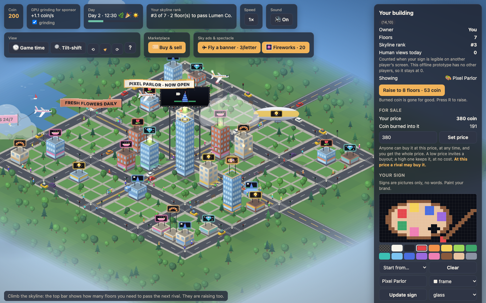
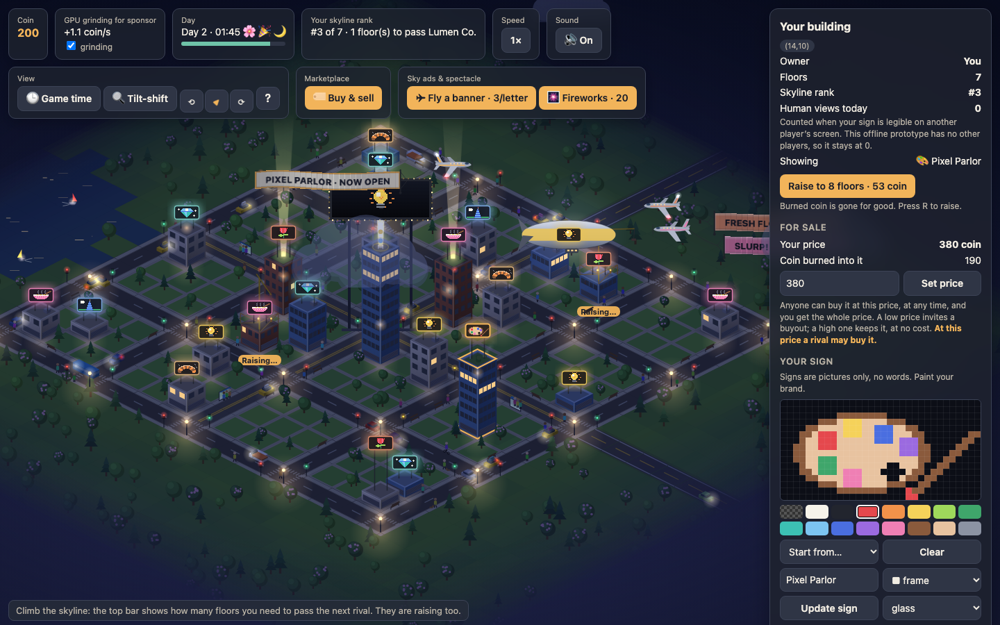
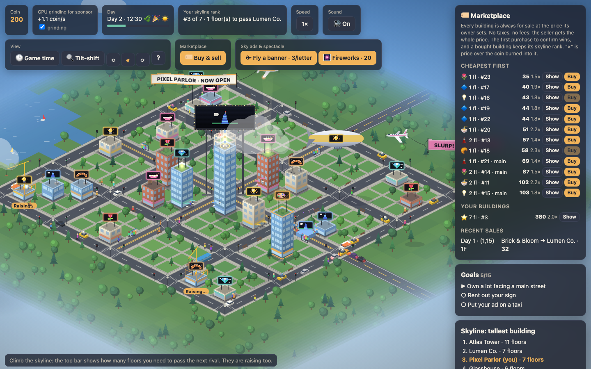
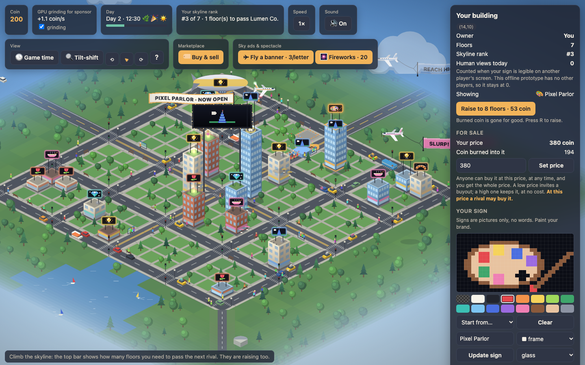
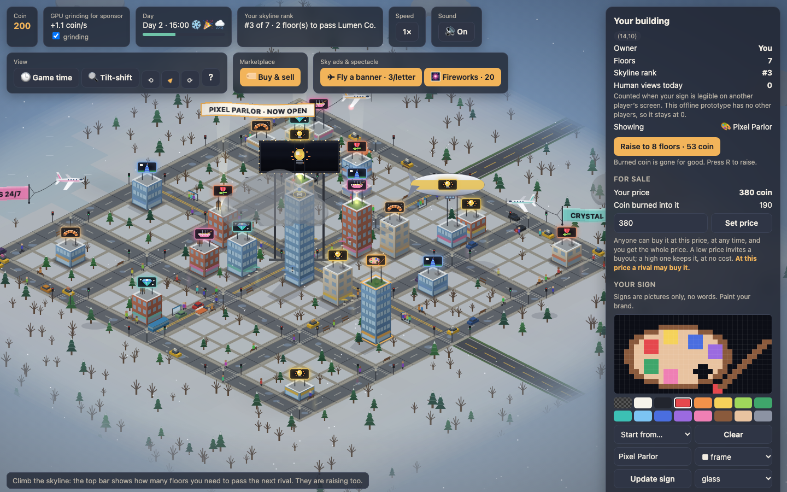
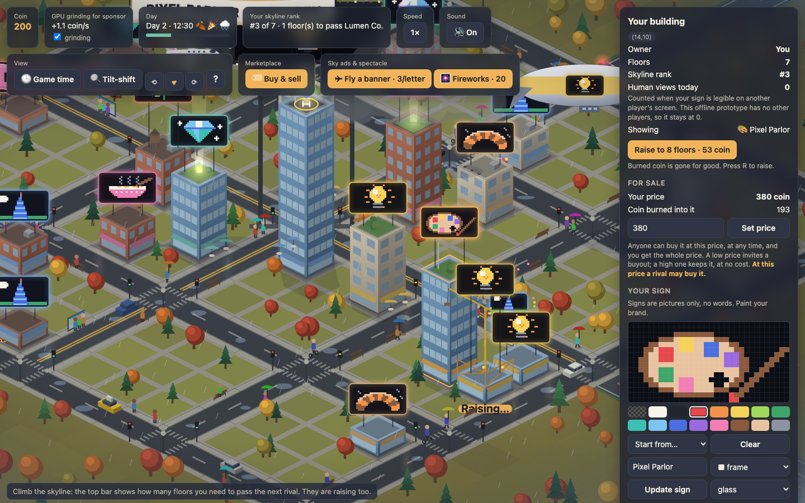
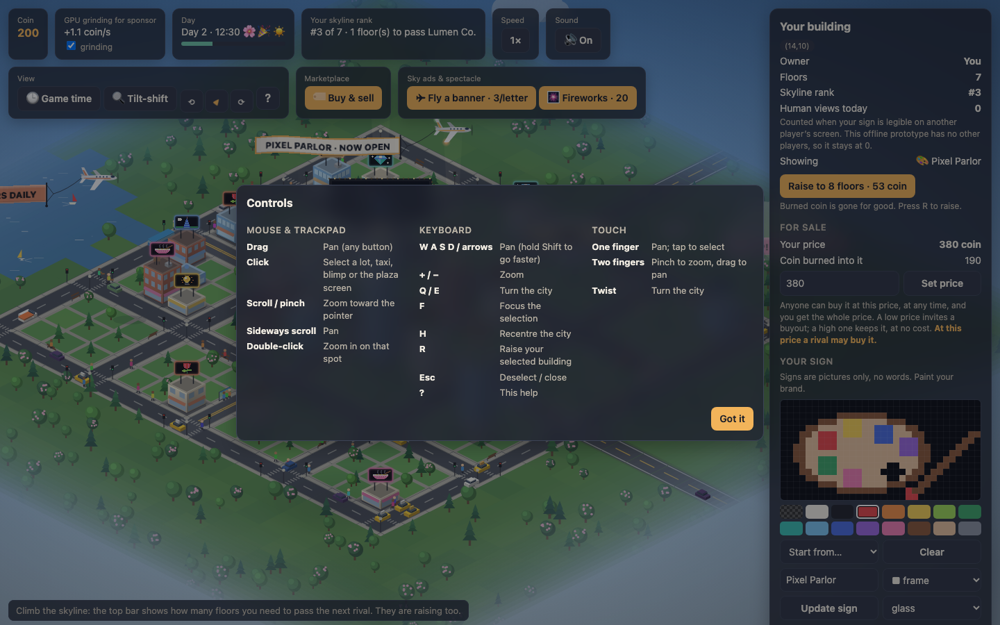

# Skylot

A browser city tycoon about advertising and height. Buy a lot, burn coin to raise your tower above the skyline, and paint a pixel-art sign the whole city can see. Every building is always for sale at the price its owner sets.

> **Prototype.** This is an offline, single-file prototype that tests whether the skyline race is fun. Rivals are simulated, and there is no chain or server yet.

## Play

Download or clone the repo, then open `index.html` in a browser. There's no build step and no server.

- `index.html?demo` starts with a built-up lot.
- Press `?` in the game for every control.

## Controls

| | Mouse & trackpad | Keyboard | Touch |
|---|---|---|---|
| Pan | Drag; sideways scroll | W A S D / arrows (Shift = fast) | One finger |
| Zoom | Scroll or pinch, toward the pointer | `+` / `−` | Pinch |
| Turn the city | ⟲ / ⟳ (the compass turns back to north) | Q / E | Twist |
| Select | Click; double-click zooms in | F focus, Esc deselect | Tap |
| Other | | H recentre, R raise your building, ? help | |

## What's in it

- **Land and height:** lots are priced by location. Each floor costs more coin to burn than the last, and the skyline board ranks everyone's tallest building.
- **Signs are art:** you paint your sign in a pixel editor, with no words. The only text ad is a banner towed by a plane, at 3 coin a letter. Other sky ads include taxi-top ads, the blimp, the plaza billboard and fireworks.
- **Marketplace:** every building is always for sale at its owner's price, with no taxes or fees. A bought building keeps its skyline rank, and bots and people play by the same rules.
- **A living city:**
  - Walkers on the sidewalks.
  - Traffic with signals, buses, bikes and rush hours.
  - Weather, seasons and a day/night cycle.
  - Parades, markets and marathons.
  - Planes and a blimp flying in front of the skyline.
- **Turning:** the view turns in quarter steps, so you can see signs hidden behind towers.

| | | |
|---|---|---|
|  |  |  |
|  |  |  |

## Docs

- [Game brief](docs/game-brief.md): the design on one page.
- [Dev notes](docs/dev-notes.md): rules, rendering, performance, demo URL parameters and the playtest questions.
